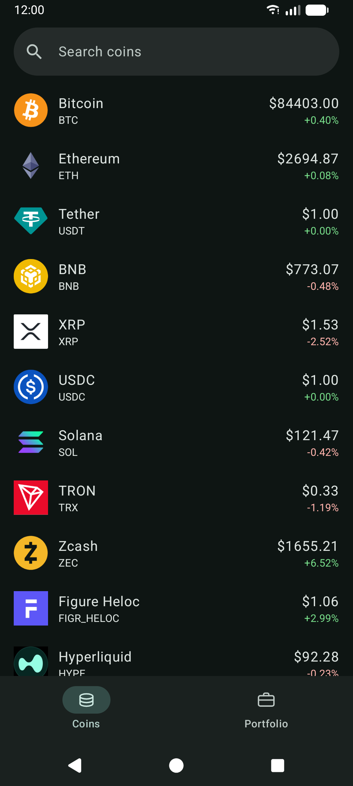
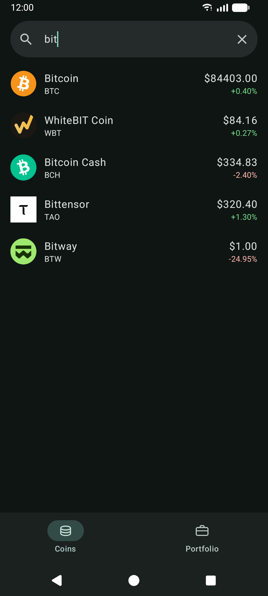
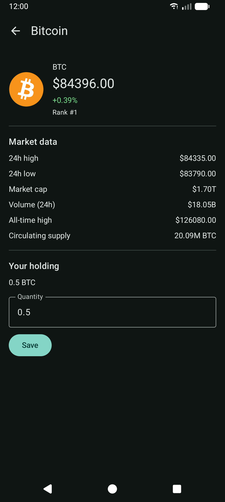
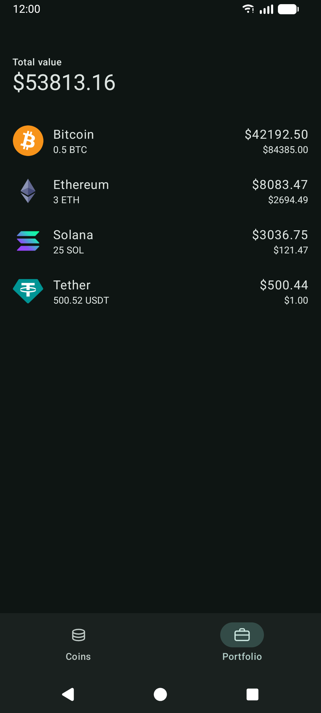
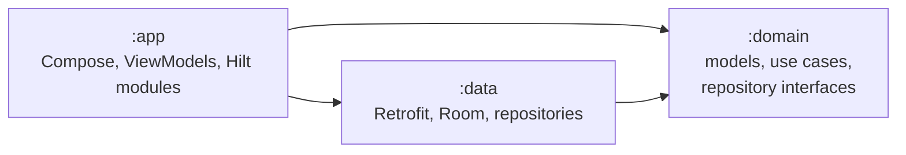

# CoinFolio

An Android app for live crypto prices and the value of the coins you own.
Data comes from the free [CoinGecko API](https://www.coingecko.com/en/api).

## Screenshots

| Coin list | Search | Coin detail | Portfolio |
|---|---|---|---|
|  |  |  |  |

## Features

- Top 50 coins by market cap, with search and pull to refresh
- Coin detail with market data
- Portfolio: save how much of each coin you own and see the total value
- Light and dark theme

## Tech stack

| Area | Libraries |
|---|---|
| UI | Jetpack Compose, Material 3, Navigation Compose (type-safe routes), Coil |
| DI | Hilt |
| Async | Coroutines, StateFlow, SharedFlow |
| Network | Retrofit, OkHttp, kotlinx.serialization |
| Storage | Room |
| Tests | JUnit 4, Truth, Turbine, Robolectric, MockWebServer, Compose UI Test |
| Code quality | Spotless + ktlint, detekt, Android Lint, Dependency Analysis Gradle Plugin |
| Build | Kotlin 2.4, Gradle 9.6, Android Gradle Plugin 9.2, version catalog, convention plugin |

## Architecture

Clean Architecture in three modules, with MVI in the UI layer.



ViewModels use only `:domain` types and get use cases, never repositories.
DTOs and Room entities never leave `:data`.

## Why these choices

1. **Three modules:** The build checks the architecture rules, and `:domain` could be moved to
   KMP later.
2. **BigDecimal:** `Double` can't store `0.1` exactly, so prices and quantities never go through
   `Double`.
3. **Local search:** `/search` doesn't return prices, and the rate limit makes a request on every
   keystroke a bad idea. So the app filters the 50 coins it already loaded.
4. **MVI:** One state per screen, all actions in one sealed type, and effects are kept separate.
   Easy to test.
5. **Hilt:** It's the official option and checks DI at compile time. All Hilt modules are in
   `:app`, so switching DI would touch one module.
6. **kotlinx.serialization:** It works well with Kotlin null safety and default values, and
   doesn't use reflection.

## Details worth a look

- **Typed errors.** Every repository returns `Resource.Success` or
  `Resource.Failure(AppError)`, so no exception reaches a ViewModel.
- **Rate limits.** HTTP 429 has its own message and is never retried. A second refresh is
  ignored while one is running. The portfolio loads all its prices with one request and keeps
  them for 30 seconds.
- **Every screen has loading, error and empty states.** An error during a refresh goes to a
  snackbar, so the rows stay on screen.

## Tests and checks

- Unit tests for use cases, ViewModels, mappers and input rules, with hand-written fakes
- `CoinApi` against MockWebServer, Room on an in-memory database
- Compose UI tests on a Gradle managed device, so no AVD setup is needed
- Spotless, detekt, Android Lint and the dependency analysis fail the build on any finding

```bash
./gradlew verifyAll
```

## Build

Open the project in Android Studio and run `app`. Needs Android 9 (API 28) or newer.
No API key is needed.

## License

MIT. See [LICENSE](LICENSE).
