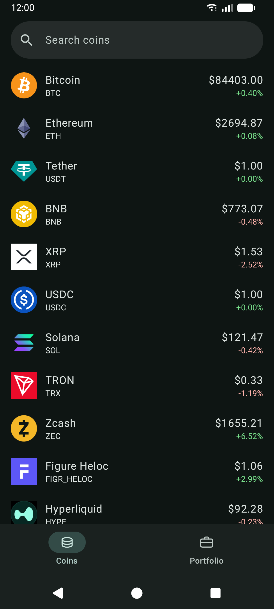
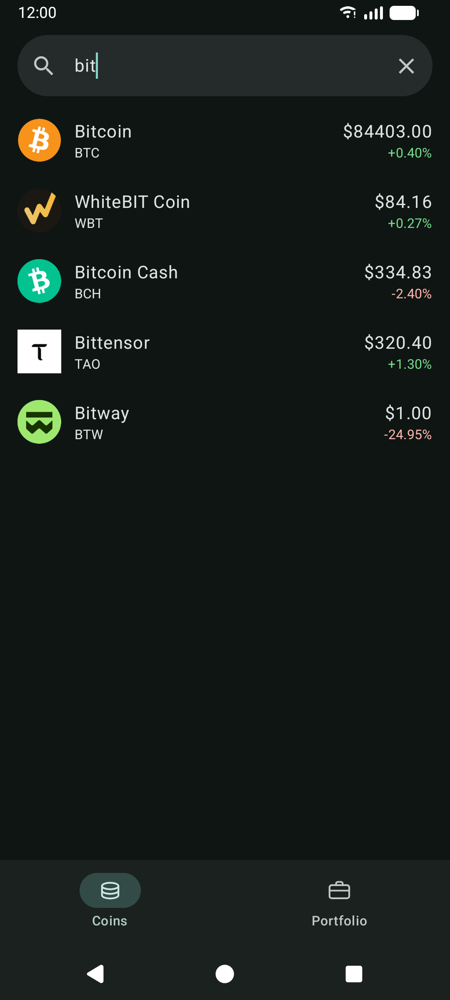
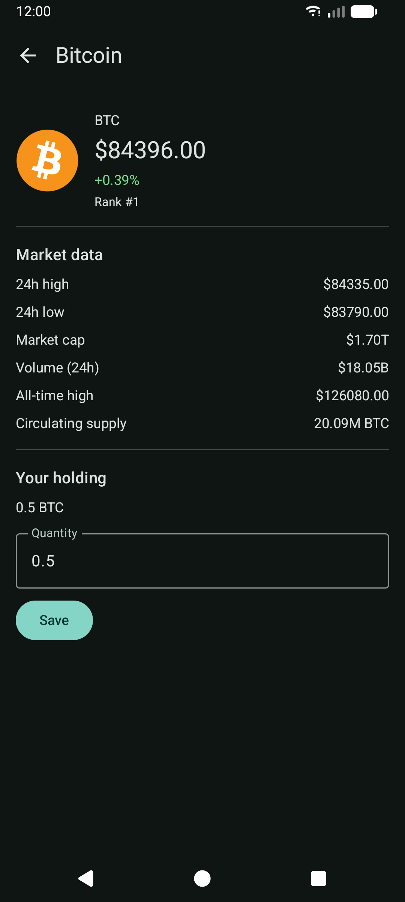
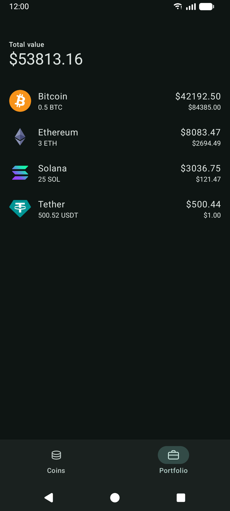
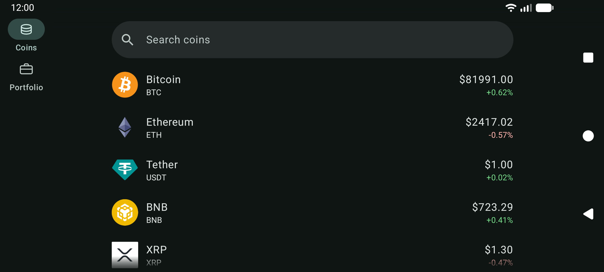
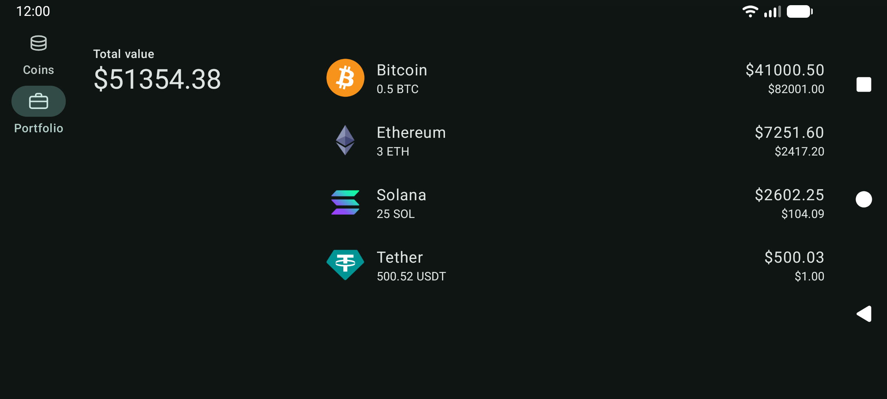
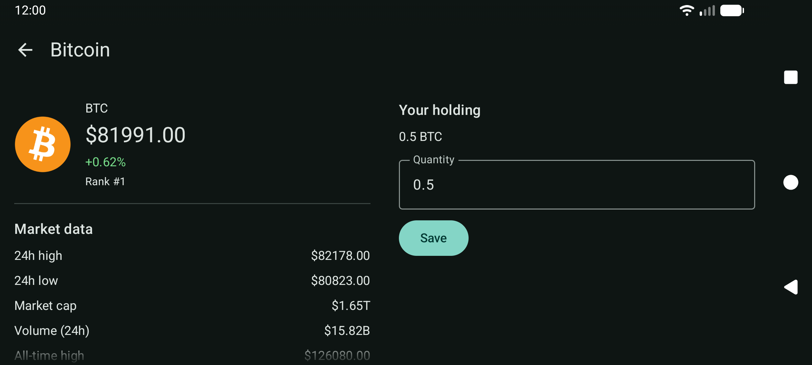
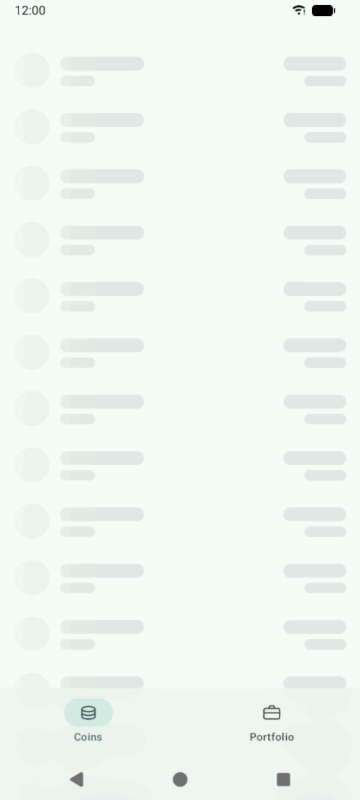
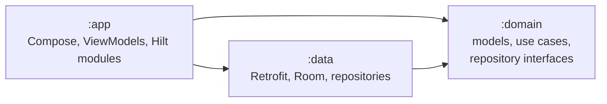

# CoinFolio

[](https://github.com/prokhorovri/CoinFolio/actions/workflows/ci.yml?query=branch%3Amain)

An Android app for live crypto prices and the value of the coins you own.
Data comes from the free [CoinGecko API](https://www.coingecko.com/en/api).

## Screenshots

| Coin list | Search | Coin detail | Portfolio |
|---|---|---|---|
|  |  |  |  |

### Landscape

| Coin list | Portfolio |
|---|---|
|  |  |
| **Coin detail** | |
|  | |

### Loading



## Features

- Top 50 coins by market cap
- Coin detail with market data
- Portfolio: save how much of each coin you own and see the total value
- Light and dark theme

## Tech stack

| Area | Libraries |
|---|---|
| UI | Jetpack Compose, Material 3, Navigation Compose (type-safe routes), Material 3 Adaptive, Coil, Haze |
| DI | Hilt |
| Async | Coroutines, StateFlow, SharedFlow |
| Network | Retrofit, OkHttp, kotlinx.serialization |
| Storage | Room |
| Tests | JUnit 4, Truth, Turbine, Robolectric, MockWebServer, Compose UI Test |
| Code quality | Spotless + ktlint, detekt, Android Lint, Dependency Analysis Gradle Plugin |
| Build | Kotlin 2.4, Gradle 9.6, Android Gradle Plugin 9.2, version catalog, convention plugin |
| CI/CD | GitHub Actions, Gradle managed devices, R8 |

## Architecture

Clean Architecture in three modules, with MVI in the UI layer.



## Details worth a look

- **Rate limits.** HTTP 429 has its own message and is never retried. A second refresh is
  ignored while one is running. The portfolio loads all its prices with one request and keeps
  them for 30 seconds.
- **Layout follows the window width, not the orientation.** At 600dp and wider (the M3
  "medium" width class), a navigation rail replaces the bottom bar. The portfolio and the coin
  detail split into two panes.
- **No `NavigationSuiteScaffold`.** It places the content above the bar. The bottom bar here
  blurs the content under it (Haze), so the content must go under the bar.

## Tests and checks

- Unit tests for use cases, ViewModels, mappers and input rules, with hand-written fakes
- `CoinApi` against MockWebServer, Room on an in-memory database
- Compose UI tests on a Gradle managed device, so no AVD setup is needed
- Spotless, detekt, Android Lint and dependency analysis checks fail the `check` task if they
  find any issues

```bash
./gradlew verifyAll
```

## CI/CD

GitHub Actions runs three jobs on every pull request targeting `main` or `dev`:
Static checks, Unit tests and UI tests. The UI tests run on the same Gradle managed
device as locally.

A tag like `v1.0.0` on `main` starts a release.

## License

MIT. See [LICENSE](LICENSE).
